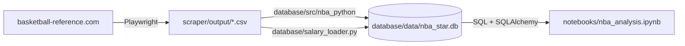

# مستندات پروژه تحلیل داده‌های NBA

پروژه‌ی اول بوت‌کمپ تحلیل داده‌ی کوئرا، تابستان ۱۴۰۵. داده‌ها از basketball-reference.com جمع شده‌اند و بازه‌ی همه‌ی تحلیل‌ها فصل‌های 2019-20 تا 2023-24 است.

## مسیر کار



1. **جمع‌آوری داده:** اسکرپر برای هر فصل آمار totals و advanced (فصل عادی و پلی‌آف)، فهرست تیم‌ها، رأی MVP، قهرمان و حقوق بازیکنان را در `scraper/output/<season>/` ذخیره می‌کند.
2. **دیتابیس:** طرح ستاره‌ای با ۵ جدول بُعد و ۴ جدول واقعیت، ساخته‌شده با SQLAlchemy (`database/README.md` و نمودار `database/NBA_Star_Schema_ERD.mmd`). حقوق با `database/salary_loader.py` وارد جدول `fact_player_salary` شده است.
3. **تحلیل:** نوت‌بوک داده‌ی هر بخش را با کوئری SQL از دیتابیس می‌خواند. قبل از هر آزمون، داده تمیز می‌شود و چولگی، داده‌ی پرت و نرمال بودن بررسی می‌شود.

## ساختار نوت‌بوک

| بخش | موضوع |
|---|---|
| ۱ | کتابخانه‌ها و تنظیمات |
| ۲ | خواندن داده‌ها و بررسی سلامت دیتابیس |
| ۳ | پاک‌سازی داده‌ها: داده‌های خالی و پرت |
| ۴ | شناخت داده‌ها: ویژگی‌های بدنی، عملکرد، تیم‌ها و قهرمانان، رابطه میان آمار بازیکنان |
| ۵ | معیار انتخاب بازیکنان برتر |
| ۶ | سؤال‌های پروژه (آمار توصیفی) |
| ۷ | فرضیه‌های پروژه (آزمون فرض) |
| ۸ | تحلیل‌های تکمیلی: حقوق و عملکرد، پیش‌بینی حقوق، سن طلایی |

## جواب سؤال‌ها و فرضیه‌ها

| | سؤال یا فرضیه | جواب |
|---|---|---|
| سؤال ۱ | قد بازیکنان لیست Michael Jordan Trophy در برابر ۵۰ بازیکن برتر هر فصل | فرق معناداری ندارند. نامزدهای MVP به‌طور میانگین ۱.۹ سانتی‌متر کوتاه‌ترند (۲۰۰.۷ در برابر ۲۰۲.۶)، ولی p برابر ۰.۱۷ است و بازه‌ی اطمینان بوت‌استرپ صفر را شامل می‌شود. |
| سؤال ۲ | تجربه و قد بازیکنان فعال تیم قهرمان در دو فصل آخر در برابر ۱۵ بازیکن برتر | بازیکنان فعال قهرمان (چرخش اصلی دنور و بوستون) با ۱۵ برتر فرق معناداری ندارند؛ تجربه p برابر ۰.۴۹ و قد ۰.۳۶. اگر کل فهرست تیم حساب شود، ۱۵ برتر باتجربه‌ترند (p برابر ۰.۰۰۳)، چون بازیکنان جوان نیمکت وارد مقایسه می‌شوند. |
| سؤال ۳ | پیشنهاد سه پوینت‌گارد بر اساس حضور در لیست MVP | لوکا دونچیچ، شای گیلجس-الکساندر و استفن کری (برای قرارداد کوتاه‌مدت). جیلن برانسون گزینه‌ی ارزان‌تر است. کریس پال با وجود سه حضور، به‌خاطر سن ۳۹ سال و افت عملکرد کنار گذاشته شد. |
| فرضیه ۱ | چابکی (قد تقسیم بر وزن) ۲۰ بازیکن برتر در دو فصل اخیر بیشتر شده است | رد نمی‌شود. میانگین ۲٪ بیشتر شده ولی معنادار نیست (p برابر ۰.۲۱). |
| فرضیه ۲ | توانایی ذاتی (تجربه تقسیم بر سن) بازیکنان فعال تیم قهرمان در دو فصل اخیر بیشتر شده است | رد نمی‌شود (Welch p برابر ۰.۳۸ و Mann-Whitney p برابر ۰.۳۷). |

## تحلیل‌های تکمیلی

| تحلیل | یافته |
|---|---|
| رابطه میان آمار بازیکنان | قد با ریباند همبستگی ۰.۶۲ دارد؛ درصد استفاده از توپ با امتیاز ۰.۸۳، ولی با دقت شوت رابطه‌ی معناداری ندارد. |
| حقوق و عملکرد | همبستگی مثبت و متوسط (اسپیرمن ۰.۴۴)؛ برای بازیکنان باتجربه قوی‌تر (۰.۵۰) و برای تازه‌کاران ضعیف (۰.۱۷). |
| پیش‌بینی حقوق | مقایسه‌ی رگرسیون خطی، Ridge، جنگل تصادفی و XGBoost برای پیش‌بینی حقوق فصل بعد از روی آمار فصل جاری. |
| سن طلایی | عملکرد هر بازیکن تا حدود ۲۵ تا ۲۷ سالگی بهتر می‌شود و از ۲۷ سالگی افت می‌کند؛ بعد از ۳۳ سالگی حدود ۰.۷ BPM در هر فصل. |

## اجرا

```bash
pip install -r requirements.txt
setup_git_notebooks.bat
jupyter lab notebooks/nba_analysis.ipynb
```

دیتابیس آماده در `database/data/nba_star.db` است. برای ساختن دوباره‌ی داده، اسکرپر با `python -m scraper.main` اجرا می‌شود.

## اعضای تیم

| اسم | کار |
|---|---|
| علی خوش‌اخلاق | سرگروه، ورود حقوق به دیتابیس، رابطه میان آمار بازیکنان، سؤال ۲ و ۳، تیم‌ها و قهرمانان، سن طلایی |
| محمدحسین میرمعصومی | اسکرپر، فرضیه ۱ |
| آرمین نورمحمدی | طراحی و ساخت دیتابیس، فرضیه ۲ |
| محسن منصف | معیار بازیکن برتر، رابطه حقوق و عملکرد |
| علی کریمی | پاک‌سازی داده‌ها، پیش‌بینی حقوق |
| ساره هداوندی | ویژگی‌های بدنی و عملکرد بازیکنان، سؤال ۱ |

## محدودیت‌ها

- داده فقط پنج فصل و پنج قهرمان دارد، پس آزمون‌هایی که روی قهرمان‌ها انجام شده نمونه‌ی کوچکی دارند.
- یک بازیکن در چند فصل تکرار می‌شود و مشاهده‌ها کاملاً مستقل نیستند.
- برد و باخت تیم‌ها و آمار حریف در دیتابیس نیست؛ برای موفقیت تیم از جمع Win Shares بازیکنانش استفاده شده است.
- قد و وزن عدد ثبت‌شده‌ی سایت است، نه اندازه‌گیری هر فصل. قد تقسیم بر وزن بیشتر لاغری را نشان می‌دهد تا چابکی.
- حقوق قراردادهای دوطرفه در سایت ثبت نشده و حدود ۱۰٪ بازیکن-فصل‌ها حقوق ندارند.
